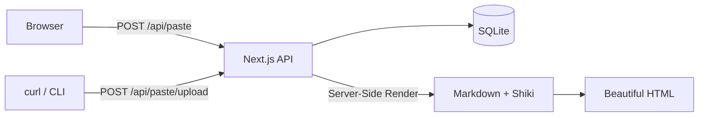
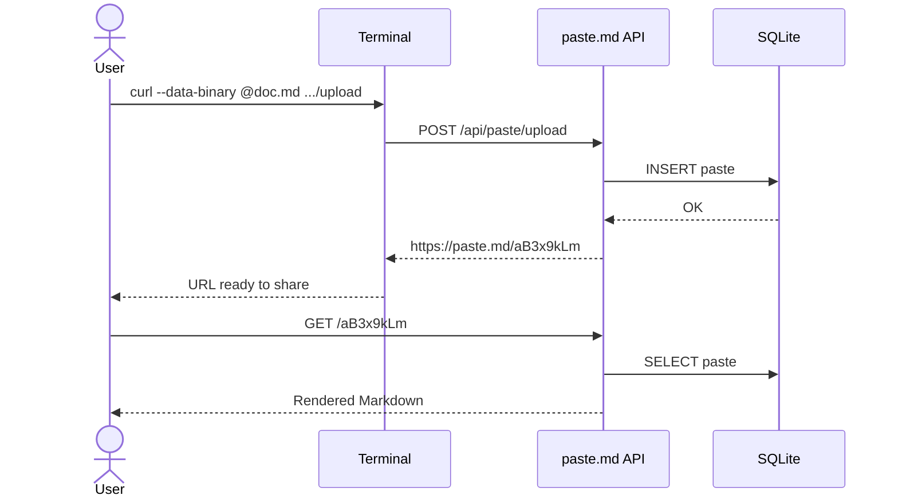
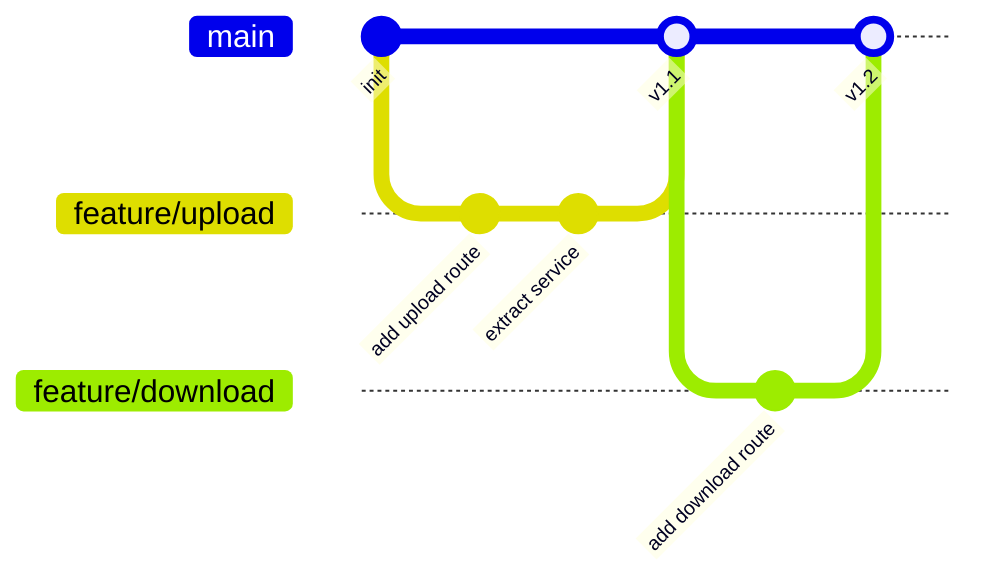

# paste.md

A zero-friction pastebin for beautiful Markdown. Paste it, share it, done.

---

## Why paste.md?

You write Markdown every day — in READMEs, docs, notes, design proposals. But sharing a quick snippet usually means one of these:

- Dump it in Slack where it renders *okay* at best
- Create a gist and lose it in the noise
- Spin up a whole doc just to share three paragraphs

**paste.md** gives you a shareable link with gorgeous rendering in under two seconds. From the browser or straight from your terminal.

---

## Terminal-First Workflow

Upload any Markdown file with a single `curl` command:

```bash
# Upload a file
curl --data-binary @design-doc.md https://paste.md/api/paste/upload

# Pipe from stdin
echo "# Quick Note" | curl --data-binary @- https://paste.md/api/paste/upload

# Set an expiration (1h, 1d, 1w, 1m)
curl --data-binary @meeting-notes.md "https://paste.md/api/paste/upload?expiration=1w"

# Download it back as .md
curl -OJ https://paste.md/api/paste/{id}/download
```

You get back a URL. That's it. Share it, and whoever opens it sees your Markdown rendered beautifully — not raw text.

### Shell Helpers

Drop these into your `.bashrc` or `.zshrc` for one-word paste and download:

```bash
paste() {
  if [ $# -lt 1 ]; then
    echo "Usage: paste <file>"
    return 1
  fi
  curl --data-binary @$1 "https://paste.rdu2.scalelab.redhat.com/api/paste/upload?expiration=1d"
}

copy() {
  if [ $# -lt 1 ]; then
    echo "Usage: copy <paste id>"
    return 1
  fi
  curl -OJ https://paste.rdu2.scalelab.redhat.com/api/paste/$1/download
  cat $1.md
}
```

Then it's just:

```bash
paste design-doc.md    # → prints the URL
copy aB3x9kLm          # → downloads and prints the paste
```

---

## Syntax Highlighting

Server-side rendered with VS Code-quality themes. Zero client-side JavaScript for highlighting — it just works.

### TypeScript

```typescript
interface Paste {
  id: string;
  content: string;
  createdAt: number;
  expiresAt: number | null;
}

async function createPaste(content: string): Promise<Paste> {
  const response = await fetch("/api/paste", {
    method: "POST",
    headers: { "Content-Type": "application/json" },
    body: JSON.stringify({ content, expiration: "1w" }),
  });
  return response.json();
}
```

### Python

```python
from dataclasses import dataclass
from datetime import datetime, timedelta

@dataclass
class Metric:
    name: str
    value: float
    timestamp: datetime

def aggregate(metrics: list[Metric], window: timedelta) -> dict[str, float]:
    cutoff = datetime.now() - window
    recent = [m for m in metrics if m.timestamp > cutoff]
    groups: dict[str, list[float]] = {}
    for m in recent:
        groups.setdefault(m.name, []).append(m.value)
    return {name: sum(vals) / len(vals) for name, vals in groups.items()}
```

### Rust

```rust
use std::collections::HashMap;

fn word_frequencies(text: &str) -> HashMap<&str, usize> {
    let mut counts = HashMap::new();
    for word in text.split_whitespace() {
        *counts.entry(word).or_insert(0) += 1;
    }
    counts
}
```

### SQL

```sql
SELECT
    p.id,
    p.size_bytes,
    datetime(p.created_at, 'unixepoch') AS created,
    CASE
        WHEN p.expires_at IS NULL THEN 'never'
        ELSE datetime(p.expires_at, 'unixepoch')
    END AS expires
FROM pastes p
WHERE p.expires_at IS NULL
   OR p.expires_at > unixepoch()
ORDER BY p.created_at DESC
LIMIT 20;
```

---

## Diagrams with Mermaid

Describe your architecture in code — paste.md renders it as a diagram automatically.

### System Architecture



### Sequence Diagram



### Git Flow



---

## Math & LaTeX

Render publication-quality equations inline or as display blocks.

### Inline Math

Einstein's famous equation $E = mc^2$ changed physics forever. The Pythagorean theorem states that $a^2 + b^2 = c^2$ for right triangles.

### Display Equations

The Gaussian integral:

$$
\int_{-\infty}^{\infty} e^{-x^2} \, dx = \sqrt{\pi}
$$

Euler's identity — often called the most beautiful equation in mathematics:

$$
e^{i\pi} + 1 = 0
$$

The probability density function of the normal distribution:

$$
f(x) = \frac{1}{\sigma\sqrt{2\pi}} \, e^{-\frac{(x - \mu)^2}{2\sigma^2}}
$$

Maxwell's equations in differential form:

$$
\nabla \cdot \mathbf{E} = \frac{\rho}{\varepsilon_0} \qquad \nabla \times \mathbf{B} = \mu_0 \mathbf{J} + \mu_0 \varepsilon_0 \frac{\partial \mathbf{E}}{\partial t}
$$

---

## Callouts & Alerts

GitHub-style alert blocks for drawing attention to important information.

> [!NOTE]
> paste.md supports the same alert syntax as GitHub Flavored Markdown. Just start a blockquote with `[!NOTE]`, `[!TIP]`, `[!IMPORTANT]`, `[!WARNING]`, or `[!CAUTION]`.

> [!TIP]
> You can upload files directly from your terminal with `curl --data-binary @file.md`. The response is just the URL — pipe it to `pbcopy` or `xclip` for instant clipboard access.

> [!IMPORTANT]
> All pastes are rendered server-side. Readers download zero JavaScript for syntax highlighting — the HTML arrives fully styled.

> [!WARNING]
> Pastes with an expiration are permanently deleted after they expire. There is no undo. Use `never` expiration for content you want to keep.

> [!CAUTION]
> Do not paste sensitive data (API keys, passwords, tokens). Pastes are accessible to anyone with the URL — there is no access control.

---

## Tables

| Feature | paste.md | GitHub Gist | Pastebin | HackMD |
|---------|:--------:|:-----------:|:--------:|:------:|
| Markdown rendering | Yes | Partial | No | Yes |
| Syntax highlighting | Yes | Yes | Yes | Yes |
| Math/LaTeX | Yes | No | No | Yes |
| Mermaid diagrams | Yes | No | No | Yes |
| GitHub-style alerts | Yes | No | No | No |
| Heading anchors | Yes | Yes | No | Yes |
| Terminal upload | Yes | Yes | No | No |
| No account required | Yes | No | Yes | Yes |
| Dark mode | Yes | No | No | Yes |
| Self-hostable | Yes | No | No | No |
| Zero JS for readers | Yes | No | No | No |

---

## Task Lists

### Launch Checklist

- [x] Markdown rendering with GFM support
- [x] Syntax highlighting (server-side, no client JS)
- [x] Math/LaTeX rendering with KaTeX
- [x] Mermaid diagram rendering
- [x] GitHub-style alert callouts
- [x] Heading anchors (hover to link)
- [x] Dark mode with theme persistence
- [x] Copy buttons on code blocks
- [x] Terminal upload via `curl`
- [x] File download endpoint
- [x] Auto-expiring pastes
- [ ] Custom vanity URLs
- [ ] Paste edit with secret token

---

## Rich Text Formatting

Every heading on this page has a clickable `#` anchor — hover over any heading to see it. Click to get a direct link to that section.

### Emphasis & Strikethrough

You can write in **bold**, *italic*, or ***both***. Mark outdated info with ~~strikethrough~~.

### Blockquotes

> "The best tool is the one that gets out of your way."
>
> Paste your Markdown. Get a link. That's the whole product.

### Nested Lists

1. **Server-side rendering**
   - Markdown parsed on the server
   - Shiki highlights code at build time
   - Client receives pure HTML — no JS needed to read a paste
2. **Smart defaults**
   - GFM enabled out of the box
   - Sanitized HTML for security
   - Responsive typography via Tailwind
3. **Self-hosted & private**
   - SQLite database — single file, zero ops
   - Docker image under 200MB
   - Your data stays on your server

### Footnotes

paste.md uses react-markdown[^1] with remark-gfm[^2] for rendering and Shiki[^3] for syntax highlighting.

[^1]: [react-markdown](https://github.com/remarkjs/react-markdown) — React component to render Markdown as React elements, no `dangerouslySetInnerHTML`.
[^2]: [remark-gfm](https://github.com/remarkjs/remark-gfm) — Plugin for GitHub Flavored Markdown: tables, task lists, strikethrough, autolinks.
[^3]: [Shiki](https://shiki.style) — Syntax highlighter using VS Code's TextMate grammars. Server-rendered, zero client JS.

---

## Inline Code & Mixed Content

Use the `nanoid` library to generate URL-safe IDs like `aB3x9kLm`. The paste is stored in SQLite via `INSERT INTO pastes` and retrieved with a simple `SELECT` — no ORM magic, just `drizzle-orm` keeping the types honest.

Here's a config snippet you might put in a doc:

```yaml
services:
  paste-md:
    image: paste-md:latest
    ports:
      - "3000:3000"
    volumes:
      - paste-data:/data
    environment:
      DATABASE_URL: /data/paste.db

volumes:
  paste-data:
```

---

## Try It Now

```bash
# Create this file locally, then upload it
curl --data-binary @showcase.md https://paste.md/api/paste/upload
```

That's it. No sign-up. No configuration. Just Markdown, rendered beautifully.
